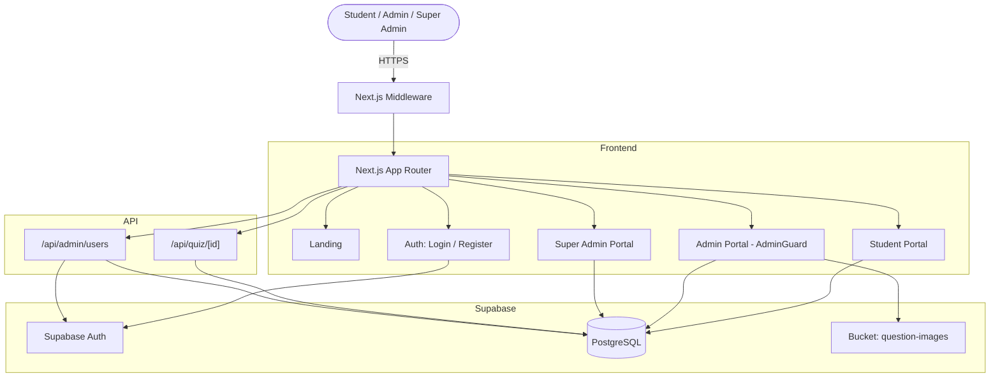

<div align="center">

# 🎓 O/L Science Quiz Platform

### Sri Lanka's free online Science quiz engine for O/L students

*Timed exams · Island-wide leaderboards · Bilingual content · Live admin control*

[](https://nextjs.org/)
[](https://react.dev/)
[](https://www.typescriptlang.org/)
[](https://tailwindcss.com/)
[](https://supabase.com/)

</div>

---

## 📖 Table of Contents

- [Overview](#-overview)
- [Key Features](#-key-features)
- [Architecture](#-architecture)
- [Tech Stack](#-tech-stack)
- [Project Structure](#-project-structure)
- [Getting Started](#-getting-started)
- [Environment Variables](#-environment-variables)
- [Database Setup](#-database-setup)
- [Security Model](#-security-model)
- [Question Bank & Medium Support](#-question-bank--medium-support)
- [Quiz Engine & Timer](#-quiz-engine--timer)
- [Leaderboards](#-leaderboards)
- [Roles & Permissions](#-roles--permissions)
- [Admin Guide](#-admin-guide)
- [Deployment](#-deployment)
- [Troubleshooting](#-troubleshooting)
- [License](#-license)

---

## 🌟 Overview

The **O/L Science Quiz Platform** is a full-stack, cloud-native online examination system built for Sri Lankan **G.C.E. Ordinary Level** students.

It replaces manual exam workflows, spreadsheet grading, and disjointed communication with a unified web application that:

1. **Onboards students in seconds** — name, email, school, and chosen medium. No codes, no paperwork.
2. **Runs timed exams** with database-enforced invariants (single attempt, 20-question cap per quiz).
3. **Supports bilingual content** — Sinhala (primary) and English (optional) question texts, options, and explanations.
4. **Decouples questions from quizzes** via a central Question Bank + `quiz_questions` junction table.
5. **Computes multi-tier leaderboards** — per-quiz live top-10 and island-wide cumulative rankings.
6. **Gives admins real control** — schedule quizzes, publish instantly, monitor submissions in real time.
7. **Reserves a super-admin tier** for managing admins and removing users.

---

## ✨ Key Features

### 🎓 Student Experience

- **Fast onboarding** — name + email + school + medium, nothing else
- **Medium-aware** — Sinhala students see Sinhala quizzes only; English students see English quizzes only
- **Interactive exam UI** — question palette, live countdown, autosave, bilingual toggle
- **Auto-submit** — quiz submits itself the moment the timer reaches zero
- **Review mode** — every question with correct/wrong highlighting and full explanation
- **Analytics dashboard** — exams taken, average %, best score, island rank, past results table
- **Leaderboard** — island-wide rankings with medals, search, and your pinned rank bar

### 🛡 Admin Experience

- **Central Question Bank** — full CRUD, bilingual inputs, image upload, 4 or 5 options with explanations
- **Quiz Scheduler** — pick questions from the bank via a live capacity-counted modal, publish/unpublish instantly
- **Per-quiz question manager** — reorder with ▲▼, attach, or detach without deleting bank assets
- **Performance analytics** — filterable attempts table with colour-coded score badges and CSV export
- **Executive dashboard** — questions, students, quizzes, published count, submissions at a glance
- **Two-step admin gatekeeper** — password + bcrypt-verified access code stored in `admin_secrets`, session token in `sessionStorage`

### 👑 Super Admin Experience

- **User management page** — see every admin and student on the platform
- **Create admins** — directly via service-role API, no email confirmation required
- **Promote students to admins** — one click, reversible
- **Demote admins back to students** — one click, guarded by "can't demote the last super admin"
- **Delete any non-super-admin user** — cascades through profiles, results, and answers
- **Guard rails** — cannot delete or demote yourself; cannot touch other super admins

### 📱 Responsive Design

- Mobile-first layouts across every page
- Touch targets ≥ 44px on primary actions
- Horizontal scroll on wide tables
- Sticky headers, mobile drawers, and adaptive grids

---

## 🏗 Architecture



---

## 💻 Tech Stack

| Layer | Technology | Purpose |
|---|---|---|
| Framework | Next.js 15 (App Router) | SSR, Route Handlers, Edge Middleware |
| Runtime | React 19 | Server + Client Components |
| Language | TypeScript 5.x | End-to-end type safety |
| Styling | Tailwind CSS v4 | Zero-runtime utility CSS |
| Icons | Lucide React | Consistent icon set |
| Database | PostgreSQL (Supabase) | Triggers, RLS, window functions |
| Auth | Supabase Auth (`@supabase/ssr`) | Cookie-based sessions |
| Storage | Supabase Storage | `question-images` bucket |
| Crypto | `pgcrypto` | bcrypt hash for admin code |
| Hosting | Vercel | Edge + serverless functions |

---

## 📁 Project Structure

```
ol-science-quiz/
├── app/
│   ├── layout.tsx                       # Root layout (fonts, metadata)
│   ├── globals.css                      # Tailwind v4 directives + utilities
│   ├── page.tsx                         # Landing page
│   │
│   ├── auth/
│   │   ├── login/page.tsx               # Email + password + inline admin code
│   │   └── register/page.tsx            # Name + email + school + medium
│   │
│   ├── api/
│   │   ├── quiz/[id]/route.ts           # Quiz loader + server-side scorer
│   │   └── admin/users/route.ts         # Super-admin user management
│   │
│   ├── student/
│   │   ├── layout.tsx                   # Header, nav, footer
│   │   ├── dashboard/page.tsx           # Stats + quizzes + past results
│   │   ├── leaderboard/page.tsx         # Island-wide rankings
│   │   └── quiz/[id]/page.tsx           # Exam engine + timer + review
│   │
│   └── admin/
│       ├── layout.tsx                   # Sidebar + super-admin nav injection
│       ├── AdminGuard.tsx               # 3-layer access check
│       ├── dashboard/page.tsx           # Executive overview
│       ├── questions/page.tsx           # Question Bank CRUD
│       ├── quizzes/
│       │   ├── page.tsx                 # Quiz scheduler
│       │   └── [id]/questions/page.tsx  # Per-quiz question manager
│       ├── performance/page.tsx         # Attempts analytics + CSV
│       └── super/page.tsx               # User management (super admin only)
│
├── components/
│   ├── ImageUploadField.tsx             # Storage + URL uploader
│   ├── QuestionBankSelectorModal.tsx    # 20-cap picker with capacity bar
│   ├── QuestionEditModal.tsx            # Bilingual question editor
│   ├── QuestionEntryForm.tsx            # Shared types + form
│   └── SchoolAutocomplete.tsx           # Fuzzy school search
│
├── lib/
│   ├── admin-session.ts                 # sessionStorage token helpers
│   ├── quiz-window.ts                   # Scheduled exam time windows
│   ├── supabaseClient.ts                # Browser Supabase client
│   └── supabase/
│       └── server.ts                    # Server Component / Route Handler client
│
├── supabase/
│   ├── 01-schema.sql                    # Master schema
│   ├── 02-storage.sql                   # Bucket + policies
│   ├── 03-rls.sql                       # Row Level Security policies
│   ├── 04-seed-schools.sql              # Curated Sri Lankan school list
│   ├── 05-admin-seed.sql                # Admin code bootstrap
│   ├── 06-super-admin.sql               # Super admin column + policies
│   └── 07-medium.sql                    # Medium (si/en) column + RPC update
│
├── middleware.ts                        # Route guards for /student/* and /admin/*
├── next.config.ts
├── package.json
├── postcss.config.mjs
├── tsconfig.json
└── .env.local.example
```

---

## ⚡ Getting Started

### Prerequisites

- **Node.js** `v20.x` or later
- **npm** `v9.x` or later
- A **Supabase** project (free tier works)
- **Vercel** account (for deployment)

### Clone & Install

```bash
git clone https://github.com/YourUsername/ol-science-quiz.git
cd ol-science-quiz
npm install
```

### Environment Setup

Copy `.env.local.example` to `.env.local` and fill in:

```env
# Supabase (required)
NEXT_PUBLIC_SUPABASE_URL=https://your-project-id.supabase.co
NEXT_PUBLIC_SUPABASE_ANON_KEY=eyJhbGciOi...
SUPABASE_SERVICE_ROLE_KEY=eyJhbGciOi...

# App URL
NEXT_PUBLIC_APP_URL=http://localhost:3000

# Initial super admin code (used once to seed the DB, then delete)
INITIAL_ADMIN_CODE=OLSCIENCE2026
```

### Run Development

```bash
npm run dev
```

Open [http://localhost:3000](http://localhost:3000).

---

## 🔑 Environment Variables

| Variable | Scope | Required | Purpose |
|---|---|---|---|
| `NEXT_PUBLIC_SUPABASE_URL` | Public | **Yes** | Supabase project endpoint |
| `NEXT_PUBLIC_SUPABASE_ANON_KEY` | Public | **Yes** | Anonymous API key (browser client) |
| `SUPABASE_SERVICE_ROLE_KEY` | Server | **Yes** | Privileged key for server-side quiz loading and user management |
| `NEXT_PUBLIC_APP_URL` | Public | Optional | Canonical URL for links in emails |

> ⚠️ **Never commit `.env.local`.** The service-role key bypasses RLS and must stay server-side.

---

## 🗄 Database Setup

Run the SQL files **in order** in your Supabase SQL Editor. Every file is idempotent — safe to re-run.

### 1. `01-schema.sql` — Master Schema

Creates:

- `profiles` (with `medium`, `is_admin`, `is_super_admin`)
- `schools` (with fuzzy-search trigram index)
- `questions` (bilingual columns for Sinhala + English)
- `quizzes` (with `medium`, `is_published`, `scheduled_at`, `duration_minutes`)
- `quiz_questions` (junction with `order_index`, 20-question DB trigger)
- `quiz_results` (single attempt per student per quiz)
- `quiz_answers` (per-question audit for review mode)
- `admin_secrets` (singleton bcrypt hash)
- RPCs: `get_student_leaderboard`, `get_quiz_leaderboard`, `get_dashboard_data`, `verify_admin_code`
- Trigger `handle_new_user()` capturing name, school, and medium

### 2. `02-storage.sql` — Storage Bucket

Creates the public `question-images` bucket with a 5MB limit and four RLS policies.

### 3. `03-rls.sql` — Row Level Security

Enables RLS on every user-facing table with appropriate policies. Also revokes `is_admin` / `is_super_admin` writes from client roles.

### 4. `04-seed-schools.sql` — School Seed Data

Runs 67 curated Sri Lankan schools with their districts using `on conflict (name) do nothing`.

### 5. `05-admin-seed.sql` — Admin Access Code

Inserts the initial admin code (bcrypt-hashed):

```sql
insert into public.admin_secrets (id, code_hash)
values (1, crypt('OLSCIENCE2026', gen_salt('bf')))
on conflict (id) do update set code_hash = excluded.code_hash;
```

> ⚠️ **Change `OLSCIENCE2026` to your own secret before running this.**

### 6. `06-super-admin.sql` — Super Admin Tier

Adds `is_super_admin`, updates `is_admin()` to include super admins, and creates `prevent_last_super_admin` trigger.

### 7. `07-medium.sql` — Medium Support

Adds `profiles.medium` and `quizzes.medium` (`'si' | 'en'`), and rewrites `get_dashboard_data` to filter quizzes by the caller's medium.

### Bootstrap Your First Super Admin

After registering normally through the UI:

```sql
update public.profiles
set is_admin = true, is_super_admin = true
where email = 'you@example.com';
```

Log out, log back in — you'll see the **Super** badge and the **User Management** nav item.

---

## 🔐 Security Model

### Two-Step Admin Verification

Admin access requires three gates:

1. **Password authentication** via Supabase Auth
2. **Database role** — `profiles.is_admin = true`
3. **Access code** — verified against a bcrypt hash stored in `public.admin_secrets` via `verify_admin_code()`

On success, `lib/admin-session.ts` writes a tab-isolated token to `sessionStorage`. Closing the tab clears it — the code is required again on the next session.

### Row Level Security

Every user-facing table has RLS enabled:

| Table | Select | Insert / Update / Delete |
|---|---|---|
| `profiles` | own row + admins see all | own row only; `is_admin` / `is_super_admin` cannot be self-set |
| `quizzes` | authenticated | admins |
| `questions` | authenticated | admins |
| `quiz_questions` | authenticated | admins |
| `quiz_results` | own + admins | own insert only |
| `quiz_answers` | own + admins | own insert only |
| `schools` | public | admins |
| `admin_secrets` | none | service role only |
| `storage.objects` (`question-images`) | public | authenticated |

**Privilege escalation guards:**

```sql
revoke insert (is_admin, is_super_admin) on public.profiles from authenticated, anon;
revoke update (is_admin, is_super_admin) on public.profiles from authenticated, anon;
```

### Database-Level Invariants

- `trg_check_quiz_question_limit` — enforces the 20-question cap on `quiz_questions` inserts
- `unique (student_id, quiz_id)` on `quiz_results` — one attempt per quiz
- `unique (quiz_id, question_id)` on `quiz_questions` — no duplicates
- `prevent_last_super_admin` trigger — cannot demote the last super admin
- Check constraint on `quizzes.medium` (`'si' | 'en'`)

### Server-Side Scoring

The exam API (`/api/quiz/[id]`) strips `correct_option` and `explanation_*` from exam-mode responses. Only after the student submits does the server score their answers against the DB key and persist the result. The client cannot manipulate scores.

---

## 📝 Question Bank & Medium Support

### Bilingual Columns

The base columns (`question_text`, `option_1..5`, `explanation`) hold **Sinhala**. Two additional column sets hold **English** (`_en`). The `correct_option` field is language-independent — option 1 in Sinhala is option 1 in English.

### Medium Rules

| Medium | Who sees it | Student filter |
|---|---|---|
| **Sinhala (`si`)** | Sinhala-medium students | `get_dashboard_data` filters `quizzes.medium = 'si'` |
| **English (`en`)** | English-medium students | `get_dashboard_data` filters `quizzes.medium = 'en'` |

Students **cannot** access quizzes from the other medium even via a direct URL — the API returns `mode: "unavailable"` with `reason: "wrong_medium"`.

### Diagram Uploads

The `ImageUploadField` component supports both direct upload to Supabase Storage (`question-images` bucket) and external URL input. Uploads validate MIME type and enforce the 5MB cap at both the client and bucket level.

### 20-Question Cap

The `QuestionBankSelectorModal` shows a live `X / 20` counter and blocks selection beyond 20. If bypassed, the database trigger `trg_check_quiz_question_limit` aborts the insert with `P0001`.

---

## ⏱ Quiz Engine & Timer

### Timer Model

`lib/quiz-window.ts` computes the exam window:

- **Upcoming**: `now < scheduled_at`
- **Active**: `scheduled_at <= now < scheduled_at + duration_minutes`
- **Expired**: `now >= scheduled_at + duration_minutes`

A student entering late receives only the remaining duration. When the timer hits zero, `finishQuiz()` runs automatically and the result is written to `quiz_results` + `quiz_answers`.

### Submission Flow

1. Student clicks **Submit** (or timer hits 0)
2. POST `/api/quiz/[id]` with `{ answers: [{ question_id, selected_option }], time_spent_seconds }`
3. Server loads the answer key for the linked questions
4. Score is computed server-side, `quiz_results` and `quiz_answers` are inserted
5. Response returns `{ result_id, score, total }`
6. Client re-fetches → API returns `mode: "review"`

### Review Mode

After submission the exam page renders review mode by reading `quiz_answers`:

- Correct answers highlighted in **emerald**
- Incorrect selections marked in **red**
- Full explanations rendered per question and per language
- Language toggle persists per browser via `localStorage`

---

## 📊 Leaderboards

### Student Leaderboard (`get_student_leaderboard`)

Ranks all non-admin students island-wide by:

1. `SUM(score)` DESC
2. `SUM(time_spent_seconds)` ASC

Rendered with medal badges for the top 3, your pinned rank bar, and a search box for name/school.

### Per-Quiz Leaderboard (`get_quiz_leaderboard`)

Returns the top-10 for a specific quiz — ordered by score, then fastest time.

### Dashboard Statistics (`get_dashboard_data`)

Single RPC returning:

- **profile** — id, name, email, school, medium
- **stats** — total exams, average %, best %, island rank
- **past_results** — all submissions with score, time, date
- **live_quizzes** — published quizzes filtered by the caller's medium

---

## 👥 Roles & Permissions

| Capability | Student | Admin | Super Admin |
|---|:---:|:---:|:---:|
| Take quizzes | ✅ | ✅ | ✅ |
| View own dashboard | ✅ | ✅ | ✅ |
| View leaderboard | ✅ | ✅ | ✅ |
| Manage question bank | ❌ | ✅ | ✅ |
| Schedule quizzes | ❌ | ✅ | ✅ |
| View performance analytics | ❌ | ✅ | ✅ |
| Create new admins | ❌ | ❌ | ✅ |
| Promote / demote users | ❌ | ❌ | ✅ |
| Delete users | ❌ | ❌ | ✅ |

The `is_super_admin` tier is stored on `profiles` and enforced at three layers:

1. **Nav rendering** — the Super Admin link only appears for super admins
2. **Page guard** — `app/admin/super/page.tsx` denies non-super-admins
3. **API guard** — `/api/admin/users` returns 403 for non-super-admins

---

## 🛠 Admin Guide

### Adding a Question

1. Go to **/admin/questions**
2. Click **New question**
3. Choose a **topic** (Biology / Chemistry / Physics / General)
4. Fill the **Sinhala** section (required) — question text, 4 or 5 options, correct option, explanation
5. Fill the **English** section (optional) — same fields
6. Upload a **diagram** if needed (PNG / JPG / WEBP / GIF, max 5MB)
7. Click **Create question**

### Scheduling a Quiz

1. Go to **/admin/quizzes**
2. Click **New quiz**
3. Choose **medium** (Sinhala / English) — students only see quizzes in their own medium
4. Set title, description, start time, and duration (5–300 minutes)
5. Toggle **Publish now** if you want it visible immediately
6. Save
7. Click **Manage questions** → add up to 20 from the bank, reorder with ▲▼
8. When ready, use the eye icon in the list to publish / unpublish

### Viewing Performance

1. Go to **/admin/performance**
2. Filter by quiz, search by student or school
3. Click **Export CSV** to download the current filtered view

### Managing Users (Super Admin)

1. Go to **/admin/super**
2. Switch between **Admins** and **Students** tabs
3. **New admin** → create an account with email + password (email confirmation is bypassed)
4. From the **Students** tab, click 🛡 **UserCog** to promote
5. From the **Admins** tab, click 🛡 **ShieldOff** to demote
6. Click 🗑 to delete a user — cascades through all their data

---

## 🚀 Deployment

### Vercel

1. Push the repository to GitHub
2. Import at [vercel.com/new](https://vercel.com/new)
3. Add environment variables:
   - `NEXT_PUBLIC_SUPABASE_URL`
   - `NEXT_PUBLIC_SUPABASE_ANON_KEY`
   - `SUPABASE_SERVICE_ROLE_KEY`
   - `NEXT_PUBLIC_APP_URL` (e.g. `https://your-domain.vercel.app`)
4. Deploy

### Post-Deploy Checklist

- [ ] All SQL files run in order in Supabase SQL Editor
- [ ] Storage bucket `question-images` created with 4 policies active
- [ ] `admin_secrets` seeded with your real access code
- [ ] At least one super admin promoted via SQL
- [ ] Supabase Auth → URL Configuration: Site URL + Redirect URLs set to your domain
- [ ] School list seeded
- [ ] Test: register (Sinhala + English), log in with email, take a quiz, review
- [ ] Test admin: create question, schedule quiz, link questions, publish
- [ ] Test super admin: create admin, promote student, delete user

### Supabase Auth Config

In **Authentication → URL Configuration**:

- **Site URL:** `https://your-domain.vercel.app`
- **Redirect URLs:** add `https://your-domain.vercel.app/student/dashboard` and `https://your-domain.vercel.app/**`

If you want to skip email confirmation during development:

- **Providers → Email** → toggle "Confirm email" off

---

## 🛠 Troubleshooting

| Symptom | Cause | Fix |
|---|---|---|
| `record "new" has no field "quiz_id"` | Obsolete trigger from an earlier migration | Re-run Section 3.6 of the master schema — it drops the obsolete trigger |
| `Quiz question limit exceeded` | Attempted to link >20 questions | Unlink a question first |
| `Key (student_id, quiz_id) is duplicated` | Same student submitted the same quiz twice | Expected — one attempt per quiz |
| Question Bank list is empty | The query still selects `quiz_id` (removed column) | Remove `quiz_id,` from the SELECT in `app/admin/questions/page.tsx` |
| Admin logged out when tab closes | `sessionStorage` cleared | Expected — re-enter access code |
| Image upload 403 | RLS policies missing on `storage.objects` | Re-run `02-storage.sql` |
| Sinhala student sees English quiz | `07-medium.sql` not run or `quizzes.medium` default is wrong | Re-run the migration and verify: `select id, medium from quizzes;` |
| `/api/admin/users` returns 404 | File not at the correct path | Must be `app/api/admin/users/route.ts` — not `.tsx`, not `index.ts` |
| `/api/admin/users` returns 403 | User is not a super admin | Promote via SQL: `update profiles set is_super_admin = true where email = '...'` |
| Login with wrong password fails silently | Supabase rate limit hit | Wait 60 seconds and retry |
| School autocomplete empty | `04-seed-schools.sql` not run | Re-run the seed file |

---

## 📄 License

Distributed under the **MIT License**. See `LICENSE` for details.

---

<div align="center">

**Built with ❤️ for Sri Lankan O/L science students.** 🇱🇰

</div>